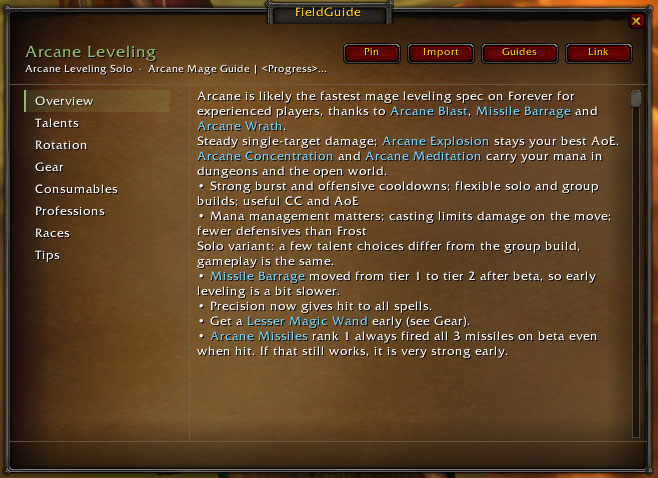
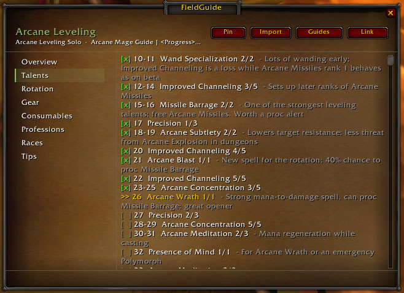
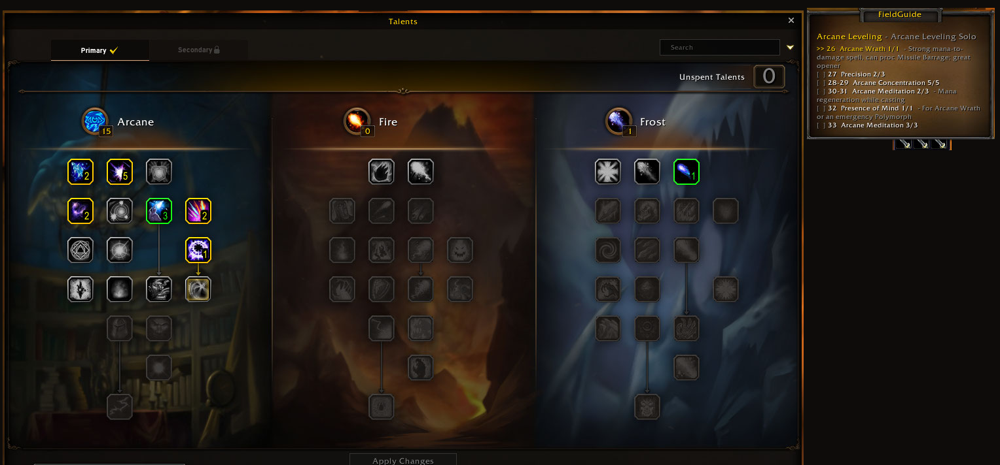

# FieldGuide

WoW Forever addon: your class guide in-game. Sections, a talent plan that ticks off as you level, the rotation for your level, a small Pin you can keep on screen, a panel beside the talent window, and a copyable link back to the guide.

*Made mainly for me and my friends. It's shared in case it's useful to others too, but expect it to follow our needs first.*

## Getting a guide into the game (any AI chat works)

1. In-game: `/guide import`, then click **AI prompt** and press Ctrl+C. The same prompt is in `AI_PROMPT.txt` in the addon folder.
2. Paste the prompt into an AI chat (ChatGPT, Claude, Gemini...) and add the guide's URL after it. If the AI can't open the page (Mobalytics loads its content with JavaScript), open the guide in your browser, select all (Ctrl+A), copy, and paste the page text instead.
3. If the guide has several builds, the AI asks which one you want.
4. Copy the AI's answer (the block starting with `!guide v1`), paste it into the import box and click **Import**.
5. The import result lists talent names that don't match your character's talent tree. If there are any, ask the AI to fix those names, or fix them in the text yourself.

## Commands

- `/guide`: show or hide the guide window (Guides button: view, use, update, rename or delete guides; Pin button: pin the section you're reading)
- **Updating a guide:** paste the new import with `/guide import`; it replaces the old one when the link and Variant match. If the Variant name changed, click **Update** on the old guide in the Guides list and paste it there instead.
- `/guide import`: paste a guide
- `/guide pin`: show or hide the Pin
- `/guide glow`: turn the glow on the next talent on or off (works in Blizzard's talent window, also when skinned by ElvUI, and in EllesmereUI's classic talent window)
- `/guide minimap`: hide or show the minimap button (left-click: guide window, right-click: Pin, drag to move)
- `/guide debug`: save a diagnostic report
- Key bindings: Key Bindings > AddOns > FieldGuide

## Screenshots

## Development

The format and decisions are in `docs/adr/` and `docs/prd/`; the vocabulary in `CONTEXT.md`. Tests (from the repo root): `luajit tests/run.lua` and `luajit tests/smoke_test.lua`. Check a converted guide with `luajit tools/validate.lua <file>`. After editing `Core/AIPrompt.lua`, run `luajit tools/print_prompt.lua` to refresh `AI_PROMPT.txt`.
